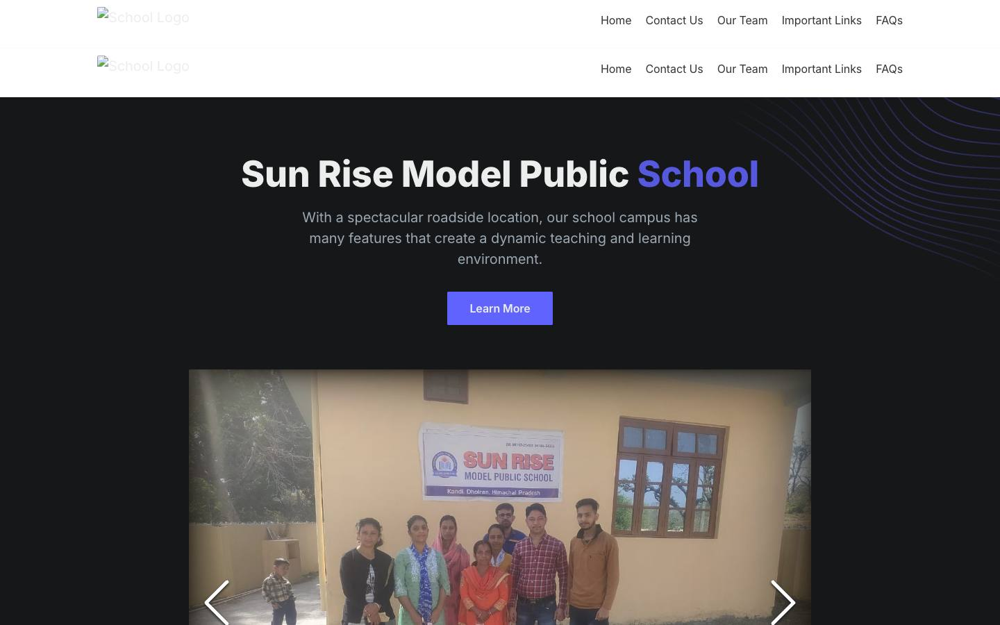
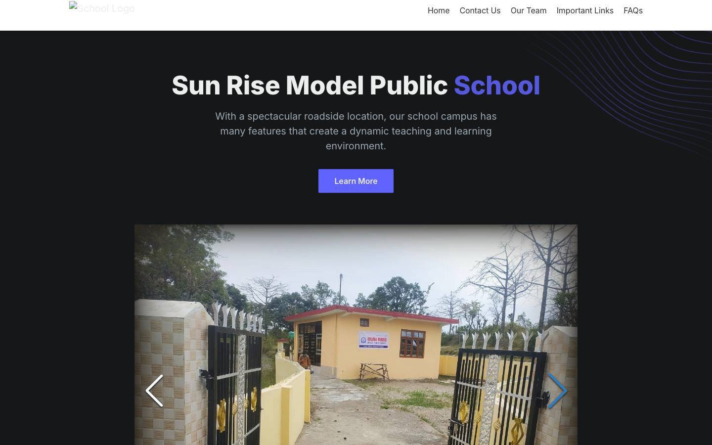
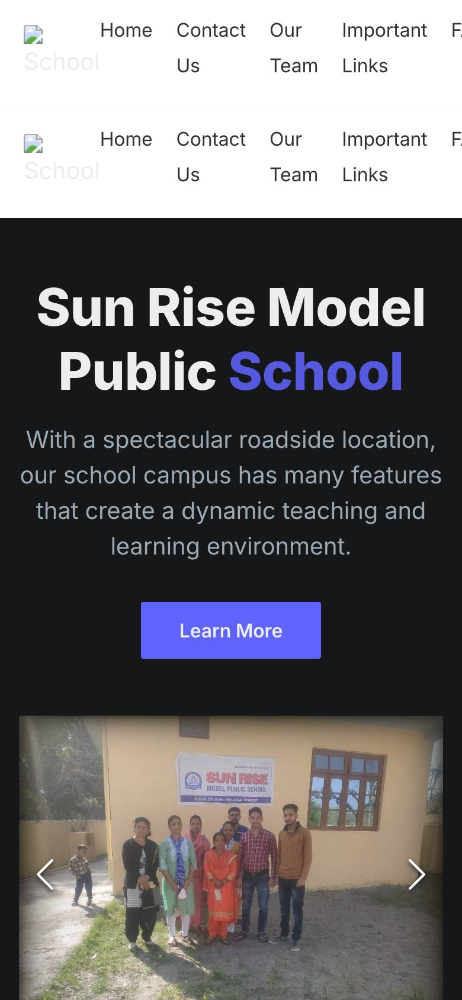

# Sun Rise Model Public School

> Website for Sun Rise Model Public School, Kandi (Kangra, Himachal Pradesh): home, team, important links, FAQs and contact.

<p align="center">
  
  
  
</p>

## Built with

React · Tailwind CSS · Create React App

## Run locally

```bash
npm install
npm start
```

## License

Built on [Open React Template](https://github.com/cruip/open-react-template) by [Cruip](https://cruip.com), which is released under the GPL-3.0 license, so this project is licensed under [GPL-3.0](LICENSE) as well. The school's name, logo, photographs and text belong to Sun Rise Model Public School and are not covered by the code license.
